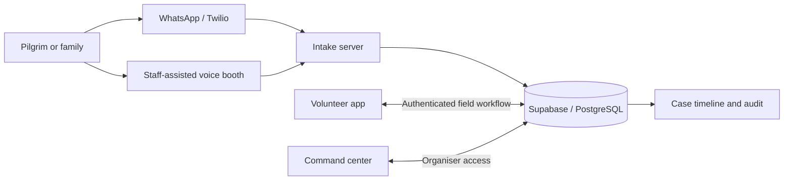

<div align="center">

# Kumbh Saathi

**Helping separated pilgrims find their way back to people who care.**

WhatsApp intake ? Voice assistance ? Volunteer response ? Command center

[](https://github.com/Prem7105/kumbh-saathi/actions/workflows/ci.yml)
[Setup guide](SETUP_AND_CHANGES.md) ? [Architecture](#how-it-works) ? [Demo](#demo-workflow) ? [Contributing](CONTRIBUTING.md) ? [Security](SECURITY.md)

</div>

Kumbh Saathi is a missing-person response prototype for the Nashik Kumbh Mela. It brings reports from WhatsApp, an assisted voice booth, and a volunteer app into one shared case workflow, with a web command center for organisers.

The focus is the person who may struggle to ask for help: a separated child, an elderly pilgrim, or someone who cannot clearly describe their location. Pilgrims can report through familiar messaging or an assisted booth while staff coordinate the response.

> **Project status:** functional prototype with local regression tests and production build checks. A configured Supabase project, staff accounts, provider credentials, and device/staging validation are required. This is not a live emergency service.

## What it does

| Surface | Who uses it | Capabilities |
| --- | --- | --- |
| **WhatsApp bot** | Pilgrims and families | Multilingual missing/found-person intake, shared-location handling, nearest police assistance, signed Twilio webhooks |
| **Saathi Didi booth** | Pilgrims with staff assistance | Speech input, avatar replies, structured intake, staff unlock, short-lived Speech tokens |
| **Volunteer app** | Approved field staff | Live cases, assigned tasks, GPS reports, SOS intake, official-record search, found-person updates |
| **Command center** | Organisers | Case queues, vulnerable-person search, operational maps, volunteer task monitor, audit views |
| **Shared backend** | All components | Supabase/PostgreSQL, staff access policies, atomic case writes, retry deduplication, realtime updates |

CCTV features provide camera **location context for manual review**. The project does not analyse footage or perform face recognition. Trust Check reports are routed for review; they do not certify payments or detect fraud automatically.

## How it works



Case creation, its timeline entry, and its audit entry commit in one database transaction. Provider/request identifiers prevent repeated case creation when a delivery is retried. Found-person updates also commit atomically: a failed write cannot leave the interface claiming completion.

## Repository layout

```text
kumbh-saathi/
??? kumbhsaathi-command-center/   Next.js + React + operational maps
??? kumbhsaathi-mobile/           Expo + React Native field app
??? kumbhsaathi-whatsapp/         Express + Twilio intake and regression tests
??? kumbhsaathi-ipad/             FastAPI + Azure Speech voice booth
??? kumbhsaathi-shared/           SQL schema, migration, seed data and scripts
??? .github/                     CI, dependency updates and issue templates
??? SETUP_AND_CHANGES.md          Deployment steps and remaining improvements
```

## Getting started

Use **Node.js 24**, npm, and **Python 3.12+**. CI uses Python 3.12 for the booth. Each application has its own dependency installation and configuration.

```bash
git clone https://github.com/Prem7105/kumbh-saathi.git
cd kumbh-saathi
```

**Configure the database first:** follow [SETUP_AND_CHANGES.md](SETUP_AND_CHANGES.md#activate-the-changes). Existing installations must apply `kumbhsaathi-shared/security-hardening.sql`; new installations use `supabase-schema.sql`. Provision approved staff accounts with administrator-controlled `organiser` or `volunteer` roles.

| Component | Setup | Local start |
| --- | --- | --- |
| Command center | [Web README](kumbhsaathi-command-center/README.md) | `npm ci`, then `npm run dev` in its directory |
| Volunteer app | [Mobile README](kumbhsaathi-mobile/README.md) | `npm ci`, then `npm start` in its directory |
| WhatsApp bot | [Bot README](kumbhsaathi-whatsapp/README.md) | `npm ci`, then `npm run dev` in its directory |
| Voice booth | [Booth README](kumbhsaathi-ipad/README.md) | Install `requirements.txt`, then run Uvicorn |

Copy each relevant `.env.example` into a local `.env` file (`.env.local` for the command center), and supply your own configuration. The client apps use the public Supabase key plus staff sign-in. The bot and booth require server-only credentials. Never put service-role or provider secrets in client environment variables.

The mobile app shows clearly labelled sample data when Supabase is unconfigured. The command center displays a setup message. The booth requires its credentials, and the WhatsApp simulator is disabled until explicitly enabled with an access token.

## Demo workflow

Use synthetic reports in a staging project:

1. Sign in to the command center as an organiser and the mobile app as a volunteer.
2. Send a missing-person report through the configured WhatsApp sandbox, including the last-seen location.
3. Confirm the live case and audit entry appear in the command center.
4. Assign a task using the volunteer account UUID; check the mobile task feed.
5. Report the person found from the selected task and verify the dashboard updates.
6. Unlock the voice booth and submit another synthetic report.
7. Ask WhatsApp for the nearest police station and share a location.

**Found is not the same as reunited.** An authorised identity and handover procedure is still required; the verified-reunification workflow is on the roadmap.

## Quality checks

CI runs four checks on pushes to `main` and pull requests:

- WhatsApp, SQL permissions/rollback, and mobile API regression tests.
- Command-center production build and TypeScript validation.
- Android JavaScript/Hermes bundle export.
- Booth authentication, token exposure, and save-failure tests.

The local baseline has **12 passing regression tests**, a successful web build, and a successful Android export. Database tests execute SQL in a local PGlite PostgreSQL instance; external providers are mocked. These checks do not replace real-device and configured-provider testing. See [verification commands](SETUP_AND_CHANGES.md#verify-locally).

## Data and access

The provided demonstration bundle contains 2,500 synthetic missing-person records, 1,280 CCTV locations, 32 zone centroids/boundary summaries, 14 police stations, and 85 chokepoint/parking records.

Bundled datasets are source assets and are visible to readers of this repository. Runtime authentication does not make GitHub files private. **Do not commit real incident reports, reporter contact details, or production database exports.** Dataset and third-party asset licensing must be confirmed before redistribution beyond the intended project context.

Runtime controls include staff roles and row-level security, organiser-only map downloads, authenticated booth access, Twilio signature checks, append-only staff audit history, and explicit save failures. Review [SECURITY.md](SECURITY.md) and the migration guide before deployment.

## Roadmap

- Verified claimant identity and authorised reunification/handover.
- Durable WhatsApp follow-up sessions and delivery processing.
- Offline field reports with persistent request identifiers.
- Operational alerting, load tests, and deployment monitoring.
- Zone/team permissions, retention rules, and controlled exports.
- Booth context across follow-up turns.

See [priorities and known limitations](SETUP_AND_CHANGES.md#next-improvements-in-priority-order) for the current boundaries.

## Team

- **Saaheer** ? WhatsApp, volunteer app, booth integration and deployment.
- **Ojayit** ? command center and booth frontend integration.
- **Prem** ? presentation and pitch materials.

Contributions: [CONTRIBUTING.md](CONTRIBUTING.md). No project license has been selected; third-party assets and datasets retain their respective rights.
